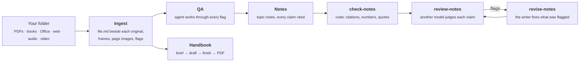

<div align="center">

# knowlib

**Turn a folder of course material into a cited Markdown library, and every lecture into a checked study handbook.**


[Quick start](#quick-start) · [How it works](#how-it-works) · [Commands](#commands) · [Model roles](#model-roles) · [Handbooks](#handbooks) · [Docs](#documentation)

</div>

---

knowlib reads PDFs and books, Office files, web pages, screenshots, audio and recorded lectures, and writes a Markdown knowledge library beside them that an agent can use for demanding academic and professional work. Every claim in it cites its source. From that library it also writes **study handbooks**: one checked, illustrated book per lecture, for a student who reads it instead of attending.

What it is built around is not extraction but **adversarial review**: every output is checked by something that did not produce it.

| Output | Produced by | Checked by |
| --- | --- | --- |
| A slide's text | a vision model | classic OCR (Apple Vision, Tesseract) |
| What the lecturer said | Whisper | a second speech model from another family (Parakeet) |
| A note's numbers and quotes | the writer model | code, against the cited page |
| A note's claims | the writer model | a reviewer from another family, never the writer |
| A handbook sentence | the agent | its transcript passage, reread; code flags hedges and unsupported numbers |
| A redrawn figure | the agent | a vision model, comparing it with the slide |

Disagreements are never settled by the producer. They become visible flags, and the strongest reader available settles each one against the original. See [docs/adversarial-review.md](docs/adversarial-review.md).

## How it works



Scripts do the mechanical work: conversion, extraction, alignment, deduplication and every check code can make. Models make the judgement calls. Every model is chosen per role in the config and none is hard-coded, so confidential material can stay entirely on the machine.

<details>
<summary><b>What a note looks like</b></summary>

```markdown
- Interest rate parity: the ratio of (1 + foreign rate) to (1 + domestic rate) equals the ratio
  of the forward to the spot rate [@principles-of-corporate-finance-1a2b3c4d, p. 803].
- WACC weights each source of capital by its market value
  [@corporate-finance-lecture-4-5e6f7a8b, slide 12, 14:32].
```

Each citation names a stable source id and a place: a printed page, a slide and time, a section, or an image.
</details>

<details>
<summary><b>What a lecture looks like</b></summary>

```markdown
## Slide 12 (14:32–16:05)
 · [full resolution](assets/frame_012.jpg)
> **OCR check:** the vision model's text and classic OCR disagree on numbers (8.5 / 8.3). Verify against the image.

**On slide:**
WACC = E/V × Re + D/V × Rd × (1 − Tc) ...

**Figure:** formula slide defining WACC, with a worked example.

**Spoken:**
[14:32] So the weighted average cost of capital ...
> [14:51] **Speech check:** Whisper heard "fifty percent"; Parakeet heard "fifteen percent".
```

Frames are kept at native resolution. Dropped frames are listed at the end with thumbnails and the model's reason, so a wrong drop leaves a trace.
</details>

## Principles

1. **Markdown is the source of truth.** Everything durable is a readable file, so any tool can be replaced without losing the library.
2. **Your originals are never edited, moved or deleted.**
3. **Every claim cites its source**: `[@source-id, slide 12, 14:32]`.
4. **The producer never grades itself.** Writer and reviewer are different models, and code checks what code can check.
5. **The original decides.** Images, transcripts and printed pages outrank captions, summaries and digests.
6. **Doubt stays visible.** Flags, "To check" lists and correction logs, never a quiet fix.
7. **Provenance on everything.** Each source records the tool and model behind each stage, so it can be redone when something better arrives.
8. **Everything resumes.** Expensive stages are cached, so an interrupted run continues where it stopped.
9. **Privacy is enforced in code.** `local_only` blocks every route off the machine. Before a prompt leaves it, emails, phone numbers and the names said in class are replaced; before an image leaves, local OCR reads it, lines with personal information are blacked out, and an image that still shows any stays local. Only with that guard in place may a library use hosts that keep data (`privacy.models_may_keep_data`).

## Quick start

**Requirements:** Python 3.11+, `ffmpeg`, `pandoc`, `tesseract` (with the language data you need), Chrome or Chromium for PDF export, and `ripgrep`. Optional: LibreOffice (slide images from `.pptx`), Typst or Graphviz (redrawn figures).

```bash
cd knowledge-library
python3 -m venv .venv && source .venv/bin/activate
pip install -e ".[docs,mac]"        # macOS: in-process speech-to-text, vision and OCR
# pip install -e ".[docs,linux]"    # Linux: speech-to-text backend
# pip install -e ".[api]"           # optional: API models through LiteLLM
# pip install -e ".[figures]"       # optional: charts for redrawn figures
```

`scripts/install-mac.sh` does all of this on macOS. Then point it at a folder:

```bash
knowlib init ~/Documents/MyCourse            # a few questions, or flags (--yes for defaults)
knowlib doctor -L ~/Documents/MyCourse       # what is installed
knowlib models -L ~/Documents/MyCourse --check
knowlib process -L ~/Documents/MyCourse      # ingest (resumable)
```

After ingestion an agent takes over, following the `AGENTS.md` written into the library:

- **process inbox:** ingest, QA every flag, write topic notes with citations, then check, review and revise them;
- **research:** answer from the notes, drilling into the sources;
- **handbook:** write one lecture's book from its brief, then check it.

<details>
<summary><b>Two layouts: in place or separate</b></summary>

- **In place**, the default for a folder that already holds material, uses your folder as it is. Each file's Markdown is written beside it (`inventory.pdf` → `inventory.pdf.md`); knowlib keeps its own files in `_knowlib/` and puts `notes/`, `INDEX.md`, `glossary.md` and `AGENTS.md` at the top.
- **Separate** keeps originals in `inbox/` and each source in `sources/<id>/`.

`library.ignore` skips files and folders by name (`Handbooks`) or by path inside the library (`Lecture 3/case.xlsx`, a copy of a file already ingested elsewhere).
</details>

## What it reads

| You add | It becomes |
| --- | --- |
| `.pdf` | text with printed page numbers. Each chart, diagram or table-as-picture is cropped, read by the vision model and checked by OCR. Scanned pages are OCR'd and flagged. |
| `.docx .pptx .xlsx .odt .rtf` | an Office source; `.pptx` slide by slide (image, text, speaker notes) |
| a folder of images | one source, one section per image, read by the vision model and checked by OCR |
| `.html`, `urls.txt`, `.url`, `.webloc` | a web source with its URL and fetch date |
| an audio or video file | a lecture: transcript, cross-checked, and the slides it shows, slide by slide |
| a folder with one video and audio files | one lecture: the video for the slides, the best audio for the transcript, aligned |
| a folder with a `session.yaml` | one lecture, configured by the sidecar |

<details>
<summary><b><code>session.yaml</code> reference</b> (all keys optional)</summary>

```yaml
title: Corporate Finance - Lecture 4
date: 2026-10-28
language: en                   # set explicitly; mixed-language lectures need it
glossary: [WACC, CAPM]         # seeds the transcription's spelling of terms and names
primary_audio: recorder.wav    # the best recording; otherwise chosen by estimated signal-to-noise
slides: slides.pdf             # the deck, ingested too and linked from the lecture
parts:                         # one lecture recorded in parts, joined in order
  - {name: Part A, audio: part1.m4a, video: screen1.mov}
  - {name: Part B, audio: part2.m4a, video: screen2.mov}
local_only: true               # nothing from this lecture leaves the machine
tags: [finance]
```
</details>

## Commands

| Stage | Command | What it does |
| --- | --- | --- |
| **Ingest** | `knowlib process -L DIR` | ingest new or changed material (resumable) |
| | `knowlib status -L DIR` | live progress, from another shell |
| | `knowlib qa -L DIR` | every flag, for the QA pass |
| | `knowlib names -L DIR` | names said in class, to keep off every model outside the machine |
| | `knowlib digest -L DIR` | a finding aid per book, never cited itself |
| | `knowlib reprocess -L DIR --where transcription.model=<old>` | redo what an older model produced |
| **Notes** | `knowlib pending -L DIR` | sources not yet synthesized into notes |
| | `knowlib check-notes -L DIR` | citations, numbers, quotations, duplicates, consolidation |
| | `knowlib review-notes -L DIR` | a second model judges every claim against its cited passages |
| | `knowlib revise-notes -L DIR` | the writer corrects the flagged claims; review again after |
| | `knowlib check-figures -L DIR` | a second vision model rereads flagged figures and tables |
| **Handbook** | `knowlib handbook -L DIR --prepare --output OUT --only "<lecture>"` | the brief for one lecture's handbook |
| | `knowlib handbook -L DIR --finish --output OUT` | check the draft, write the book and the PDF |
| | `knowlib figures make OUT/<lecture>/figures` | redraw slides in the handbook's style |
| | `knowlib match-screens -L DIR LECTURE.md` | match a recorded lecture's screens to the PDF pages they show |
| | `knowlib style -L DIR` | pick the handbook's look in the browser |

## Model roles

Each library has five roles, shown and changed with `knowlib models`:

| Role | Reads or writes | Pattern |
| --- | --- | --- |
| **reading** | slides, frames, figures, images | fast vision models |
| **digest** | books, a chapter at a time | long-context text model |
| **writer** | topic notes | a careful model |
| **review** | every claim, against its passages | a different, preferably stronger family; never the writer |
| **handbook** | one lecture's book | an agent session |

```bash
knowlib models -L DIR                                    # show; at a terminal, asks role by role
knowlib models -L DIR --use reading='server:https://host/v1|<model>|<KEY_ENV>'
knowlib models -L DIR --use review=chain:<provider>/<model>,<provider>/<model>
knowlib models -L DIR --use writer=session:<model>
knowlib models -L DIR --check                            # served, takes images, full image detail, context fits
```

<details>
<summary><b>Provider specs</b></summary>

- `server:<url>|<model>[|<env var with the key>]`: any OpenAI-compatible server, local or remote;
- `lmstudio:<model>`: a local server that knowlib loads and unloads;
- `openrouter:<vendor>/<model>`: a model on OpenRouter (key in `OPENROUTER_API_KEY` or `~/.openrouter_key`). Requests go only to hosts that neither store nor train on prompts, unless the library sets `privacy.models_may_keep_data: true`;
- `chain:<provider>/<model>,...`: API models tried in order within their daily quotas. A provider with several keys (`keys:` under `providers:`) gives each key its own place and quota in the chain;
- `session:<model>`: a subagent of the agent session;
- `default`.

knowlib refuses a review role that is the writer, and warns when the two share a model family. Before each run it checks that the models it needs answer, and stops with the fix if one does not.
</details>

Speech-to-text runs locally: Whisper writes the transcript, and NVIDIA Parakeet transcribes the same audio as a cross-check. Wherever the two hear a different name, number or negation, the lecture marks the passage with a **Speech check** line. Everything else is in the library's `config.yaml`; every key and default is in `src/knowlib/config.py`, and any stage can be overridden per lecture in its `session.yaml`.

## Handbooks

One book per lecture, made in three steps:

1. **Prepare.** knowlib writes a brief: every slide, everything said, the closest course passages and the writing rules.
2. **Write.** An agent writes the draft from the brief. It opens the image of every flagged, table, formula or chart slide, and logs each correction.
3. **Finish.** knowlib checks the draft for numbers no source supports, uneven tables, lost table rows, sentences more absolute than their source, and personal information in text and images; then it writes `handbook.md`, a `review.md` "To check" list, and the PDF.

The PDF has two columns in the library's theme, with figures redrawn as searchable vectors, and is named after the lecture and its date. The writing rules keep the lecturer's hedges, scope and qualifiers, give both sides where the lecturer and a document disagree, and leave out the class's chatter and anyone's name. See [docs/handbook-design.md](docs/handbook-design.md).

## Documentation

| Document | Covers |
| --- | --- |
| [docs/adversarial-review.md](docs/adversarial-review.md) | the checks: what produces and what checks each output, the evidence behind them, and what they cannot catch |
| [docs/system-design.md](docs/system-design.md) | how ingestion works and why, in enough detail to rebuild it |
| [docs/handbook-design.md](docs/handbook-design.md) | the handbook creator |
| [`src/knowlib/templates/CLAUDE.md`](src/knowlib/templates/CLAUDE.md) | the agent procedures written into each library as `AGENTS.md` |

<details>
<summary><b>Code map</b></summary>

```
src/knowlib/
  cli.py           the knowlib command
  config.py        defaults, config.yaml, per-lecture overrides
  contract.py      source ids, hashing, atomic writes, provenance
  manifest.py      what was processed, how, and whether it was synthesized
  router.py        turns folders into units of work
  runner.py        process: incremental runs and the last_run.json report
  layout.py        where sources, assets and caches live (in place or separate)
  setup.py         knowlib init
  models.py        the model per role, the checks before each run
  privacy.py       personal information: found, removed, reported
  digest.py        book digests
  notecheck.py     checks on topic notes
  notereview.py    the second-model review of every claim
  noterevise.py    the writer's corrections of what the review flagged
  ingestors/       pdf, office, web, text, images, media
  media/           sessions, alignment, transcription, speech check, frames, selection, OCR
  providers/       one interface over every model backend, the privacy guard
  handbook/        briefs, checks, figures, themes and the PDF
  templates/       config, agent procedures, index, glossary, style picker, handbook style
```

To add a source type, write `ingestors/<name>.py` with an `@register`'d `Ingestor` that writes through `SourceWriter`.
</details>

## Tests

```bash
pip install -e ".[dev,docs]" && python -m pytest -q tests
```

The suite generates its own material: a short lecture with slides, a separate recording with an offset, a scanned deck, PDFs, Office files, a web page and a short book with printed page labels. It runs the whole pipeline with mock models, so it needs only `ffmpeg`. The planted-error tests check that each note check and the review catch what they should, and that correct notes pass.

## Status and limits

Tested end to end on English slide lectures, from recording to handbook, and on 650-page textbooks through ingestion and the digest. Not yet tested: other and mixed languages, filmed projectors, and alignment of a real camera and recorder pair. On screen recordings, OCR flags most slides, mostly false alarms. Known limits are listed in [docs/system-design.md](docs/system-design.md) and [docs/handbook-design.md](docs/handbook-design.md).
